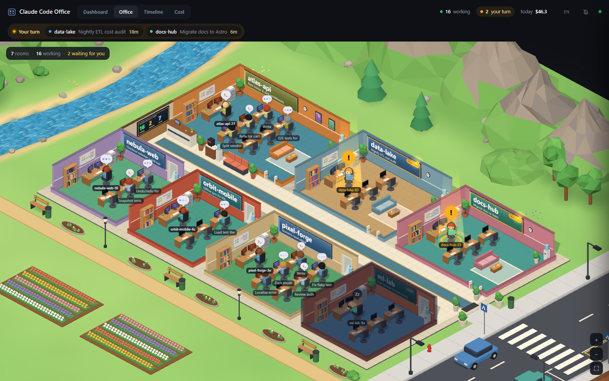
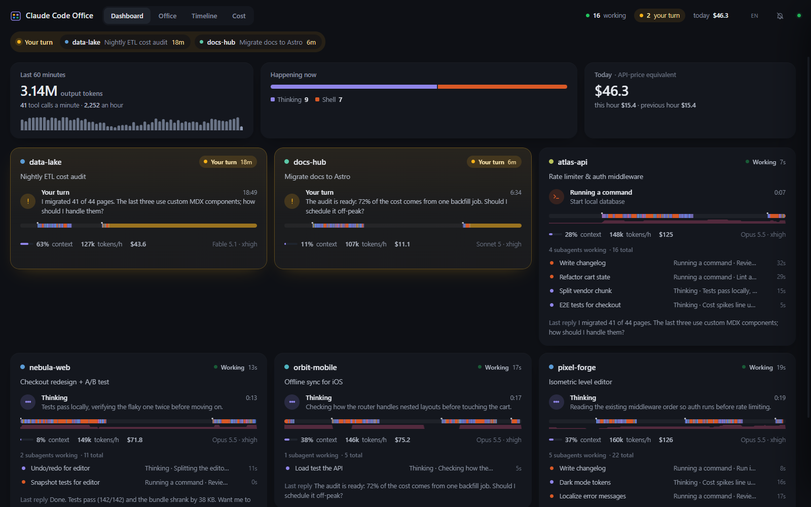
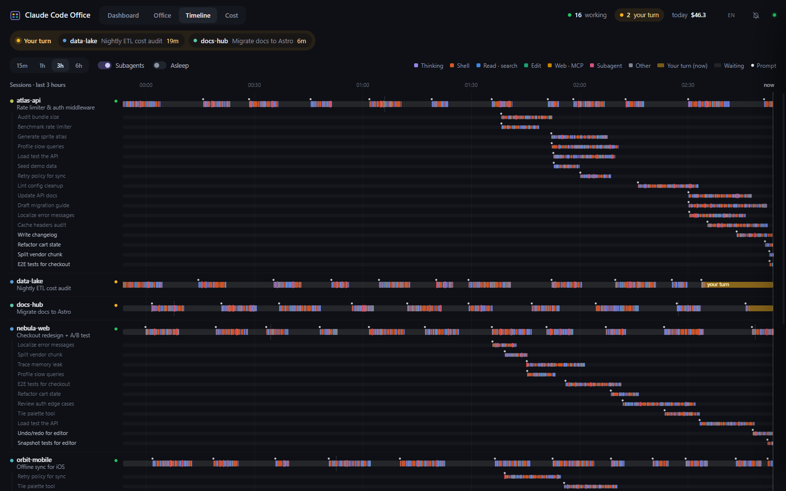
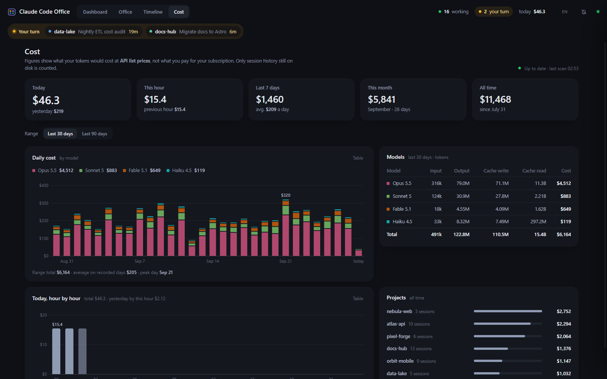
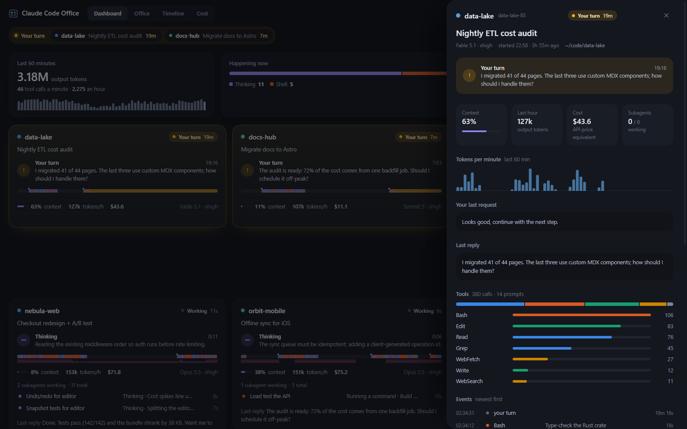

# Claude Code Office

**A live dashboard, 3D isometric office and cost tracker for your local Claude Code sessions and subagents.**
See at a glance which terminal is waiting for you, what every agent and subagent is doing right now, and what your usage would cost at API prices. Runs on `localhost`, reads your local Claude Code data read-only, zero dependencies.

[](LICENSE)




```bash
npx github:azorkai/claude-code-office
```

That's it: the server starts on <http://127.0.0.1:7321> and your browser opens. No API key, no account, no setup.

> Just want to look? Run `npx github:azorkai/claude-code-office --demo` for a fictional, self-running office.

> **About this fork.** This is a fork of [azorkai/claude-code-office](https://github.com/azorkai/claude-code-office) (MIT) with these additions:
> an optional [agent chat bridge](#agent-chat-bridge-optional), optional [Vertex AI pricing](#pricing-like-a-vertex-ai-bill-optional) for the cost tab (and each message id counted once across transcript files),
> the current tool and its description on the avatar tag, an "Open in VS Code" link in the session drawer, English fallback labels for tool events,
> and a [pixel-art Office view](#pixel-office) (isometric and front views, time of day, a sprite gallery) that replaces the 3D scene as the default; the 3D scene stays available at `?scene=3d`.
> Run it with `npx github:aaronyu-sift/claude-code-office`. Everything below is the upstream README, extended where the fork differs.

---

## Why

If you run five, ten, fifteen Claude Code terminals at once, you lose track fast:

- *Which session finished and is waiting for my answer?*
- *What are those twelve background subagents actually doing?*
- *How big has that context grown, and how much would all of this cost on the API?*

Claude Code Office answers those questions live, from the data Claude Code already writes to `~/.claude`.

## Features

- **"Your turn" radar.** Sessions that finished and are waiting for you are pulled to the front, highlighted in amber and counted in the header and the tab title; in the Office view the scene marks each one above its agent, so the amber "Your turn" strip under the header is shown in the other views only. An optional chime and desktop notification play when an agent hands the turn back.
- **Pixel-art office** (the default Office view, see [Pixel office](#pixel-office)). Every session is a themed room in a garden in the middle of a landscape of meadows and woods that fills the whole view (no sky, no backdrop, no floating island), drawn from pre-rendered voxel sprites on a 2D canvas, in an isometric or a front three-quarter view.
  - Your full chat name hangs over each lead agent; a thought bubble shows the tool in use; a beam of light and a "!" balloon mark the agent that waits for you.
  - Day and night follow your local clock: the tint of the light, lit windows, lamps and monitors after dark (there is no sun, moon or sky; the light alone tells the time).
  - Only small things move (steam, plants, butterflies, birds), at most 10 frames per second, nothing while the tab is hidden.
  - A shelf card at the right edge (dark glass, like the cards of the Setup Atlas page) lists the chats that have no room: asleep for hours, or closed in the last 14 days, newest first, each as a small sleeping or leaning figure with its full name and "closed 12m ago". The zoom buttons sit right under it. A chat that waits for you never goes there. Click an entry for its details.
- **3D isometric office** (`?scene=3d`, the original scene). It is a tycoon-game style building on a little diorama island, with streets, a river, trees and mountains. Every session is a room with its project name on the wall.
  - The lead agent sits at the big desk; subagents work at the other desks.
  - Monitors glow in the color of the current activity: thinking, shell, reading, editing, web/MCP or delegating.
  - New subagents walk in through the hall and leave when they finish. Idle rooms dim, and waiting rooms light up.
  - Street lamps and windows follow your local time of day.
  - The office drops to a low-power mode on machines without GPU acceleration.
- **Dashboard.** Each session card shows the current tool and elapsed time, a 30-minute activity strip, context-window fill, tokens per hour, session cost and live subagents.
- **Timeline.** Swimlanes for every session and subagent over the last 15 minutes to 6 hours. It shows tool calls, thinking spans, waiting time, prompts and compactions, with hover details.
- **Cost tracker.** It converts every assistant message in your transcripts into dollars at API list prices:
  - today, this week, this month and all time
  - daily chart stacked by model, hourly chart for today
  - breakdowns per model and per project
  
  The first scan runs in a worker thread; after that only new bytes are read.
- **A map with floating glass.** In the Office view the map fills the whole page; the header bar, the shelf card, the zoom buttons and the cards float over it in the same dark glass (the look of the Setup Atlas page), so nothing takes a strip of the page away from the scene. The other views keep the plain header. Every animation follows the motion rules of its kind (`docs/motion.md`: tokens in `public/app.css` and `public/js/motion.js`): what moves because of a click or a change in the scene (cards, menus, the camera, things being built) moves on a spring and settles without a jerk, colour and opacity only ease, indicators and scenery such as a flickering lamp follow the clock, clicking the interface never moves the map, and a visitor who asks for reduced motion gets short fades.
- **Card and details card.** In the Office view a click on an agent, or on a shelf entry, opens a glass card next to it (nothing slides in and nothing is dimmed): full name, project, status and time since, what it is doing, model, folder, last request and reply, tool mix and subagents. The **Open** button opens the chat where you last chose to: **VS Code** (the default, `vscode://anthropic.claude-code/open?session=<id>`), **Claude desktop** (`claude://resume?session=<id>`) or **Terminal** (the Claude Code command line, `claude-cli://open?cwd=<folder>&q=/resume <id>`, which types `/resume` into a terminal in the chat's folder but does not send it); its menu also has **Copy command line** (`cd '<folder>' && claude --resume <id>`) and **Copy session id**. The desktop and terminal links need those programs and were not verified by launching them. **All details** opens a second glass card at the right edge of the page (it fades in, nothing slides and nothing is dimmed; the same card the Dashboard and the Timeline open): per-minute tokens, cost and the full event log of a live chat, with the same Open button. Esc or its cross closes it.
- **English and Turkish UI, ready for more.** The page uses your system language when it is supported and otherwise asks you to pick one from a list (each language in its own language); the header button changes it later. A language is one file (see [Languages](#languages)).
- **Local, read-only, zero dependencies.** It binds to `127.0.0.1` only and never writes to `~/.claude`. It has no telemetry and no npm dependencies at runtime.

| Dashboard | Timeline |
|---|---|
|  |  |
| **Cost** | **Details** |
|  |  |

*All screenshots come from `--demo` mode (fictional projects).*

## Quick start

**One command (Node.js 18+):**

```bash
npx github:azorkai/claude-code-office           # start + open the browser
npx github:azorkai/claude-code-office --demo    # fictional demo office
```

**From source / double-click:**

```bash
git clone https://github.com/aaronyu-sift/claude-code-office.git
cd claude-code-office
npm start            # or double-click start-windows.bat  (macOS/Linux: ./start-macos-linux.sh)
```

**Options:**

| Flag | Default | What it does |
|---|---|---|
| `--port <n>` | `7321` | Port to listen on (always `127.0.0.1`) |
| `--open` / `--no-open` | open | Open the browser after start |
| `--demo` | off | Fictional data; does not read `~/.claude` |
| `--claude-dir <dir>` | `~/.claude` or `$CLAUDE_CONFIG_DIR` | Where Claude Code keeps its data |
| `--data-dir <dir>` | `~/.claude-code-office` | Where the cost cache is stored |
| `--closed-days <n>` | `14` | How far back closed sessions are listed on the shelf (`0` turns the shelf's closed list off) |
| `--closed-max <n>` | `50` | How many closed sessions the shelf lists at most |
| `--chat-db <file>` | off | SQLite message board to show next to the avatars, read-only (or `CCO_CHAT_DB`; see [Agent chat bridge](#agent-chat-bridge-optional)) |

## How it works

| Source | What it gives |
|---|---|
| `~/.claude/sessions/<pid>.json` | Live sessions and whether each one is busy or idle (the process must still be alive) |
| `~/.claude/projects/**/<sessionId>.jsonl` | The transcript: prompts, tool calls and results, token usage, titles, recaps |
| `…/<sessionId>/subagents/agent-*.jsonl` + `.meta.json` | Every subagent's own transcript, type and task description |

The server tails these files once per second. It reads only the last few MB of long transcripts on first start, then only the new bytes. It turns the records into agent states and events, and streams them to the browser over Server-Sent Events. Nothing is uploaded anywhere.

## Pixel office

The Office view draws a pixel-art scene: voxel models written as code in [`tools/sprites/`](tools/sprites/) are rendered once into sprite atlases (`public/pixel/atlas-iso.png`, `atlas-front.png`, with `manifest.json`), and the browser draws them on a 2D canvas. No 3D, no runtime dependencies, no build step for the app.

**Options** (URL query, for the Office view):

| Option | Effect |
|---|---|
| `?proj=iso` or `?proj=front` | The view: isometric (default) or front three-quarter. The toggle in the header does the same and the choice is remembered in the browser; the URL wins over the remembered choice. |
| `?time=HH:MM` | Pin the time of day (for example `?time=22:00`) instead of following the browser's local clock. |
| `?season=spring`, `summer`, `autumn` or `winter` | Show that season instead of the one that matches today's date. |
| `?weather=clear`, `cloudy`, `rain`, `snow` or `fog` (also `auto`, `off`) | Turn the weather on. It is off by default; `auto` picks the weather of the day from the date and the season. |
| `?hemisphere=south` | Seasons (and the length of the days) for the southern hemisphere; north is the default. |
| `?shelf=5` (a whole number from 3 to 200) | How many asleep and closed chats the shelf lists at first; 10 is the default. |
| `?gallery=1` | List every sprite of the atlas with its id. Add `&proj=front` for the other atlas. |
| `?scene=3d` | The original three.js office. |

**Time, seasons and weather.** The light follows the browser's local clock: a tint over the rooms and the garden, and lit windows, lamps and monitors after dark; the agents and their labels stay readable at every hour. The seasons follow the date (and the hemisphere): spring blossom, summer green, autumn leaves, winter snow with bare trees, a snowman, pumpkins, a bird bath and a pile of leaves; they are baked into the atlas as `<id>@spring`, `@autumn` and `@winter` sprites (summer is the plain sprite), nothing is recoloured while it runs. The weather is optional and **off by default**: clear, cloudy, rain, snow and fog, or `auto`, which picks a weather for the day from a seeded hash of the date and the season (the same day always gives the same weather; nothing is fetched from anywhere). It lives on one overlay canvas with at most 120 particles, drawn at most 10 times a second, never while the page is hidden, and not at all with `prefers-reduced-motion`; with it on, clear days bring petals in spring, falling leaves in autumn, a few flakes in winter and fireflies on summer nights, and a clear day after rain sometimes has a rainbow. Butterflies and birds by day are part of the garden in every setting.

**Settings.** The sliders button in the header (Office view) opens a small popover: camera, time of day (automatic, or fixed with a slider), season (automatic or fixed), hemisphere, weather and how many chats the shelf shows (5, 10, 20 or 50). Changes apply at once without a reload and are remembered in the browser. A URL option beats what is remembered for that visit and is not remembered itself; changing the same setting in the popover while the URL has it also updates the URL.

**Look and controls.** The scene scales in whole-number steps (no blur): `+`, `-`, the mouse wheel and pinch zoom; drag to pan; the fit button or a double click shows everything. The view never leaves the landscape: zooming out stops where the world fills the window and the pan stops at its edge. Click an agent or its label for its card (click empty ground, press Esc or use the cross to close it; it follows the agent while you pan and zoom). Rooms keep their place when agents come and go, and the theme of a room (library, lounge, lab, studio) follows its project.

**The shelf and closed chats.** Chats that have no room are listed in a glass card at the right edge of the Office view. The card floats over the map, which fills the whole page behind it (there is no side column), and "fit" frames the offices in the part that is left free; the zoom buttons sit right under the card (it scrolls on its own, and the `›` button or the `Shelf · N` tab folds it away; the choice is remembered, and it starts folded in a window narrower than 760 px, where an opened card covers most of the scene). With the card folded away, or with nothing to list, the zoom buttons float in the bottom-right corner. Two kinds of chat are there, newest first by their last activity or close time: live chats that have been asleep for hours (they leave their room), and closed chats, meaning a transcript written in the last 14 days with no live process. A chat that waits for you, works or has just finished a turn stays in its room. Only the newest ten are listed (the setting "Chats on the shelf", or `?shelf=N`); a footer in the card says "Showing the newest 10 of 37" and its "Show 10 more" button adds ten rows for the rest of the visit (a reload starts again with the setting). A chat beyond the cap is neither on the shelf nor in a room until it is among the newest. A click on an entry or on a figure in a room opens the details panel of that chat.

How the closed list is read, because it runs on your own disk: a project folder is listed again only when its modification time changes; known transcripts are only `stat`ed; only the newest `closedMax` (50) are read, and only the last 256 KB of each; a file whose size and modification time did not change is never read again; one pass stops reading after `closedBudgetMs` (150 ms) and the next pass goes on, newest first. Measured on a real `~/.claude/projects` (129 transcripts in the window, median 1.8 MB, the largest 90 MB): the first scan took 40 ms and read 50 tails, 12.5 MB; the next scans stat the files, take about 0.5 ms and read nothing (`node tools/qa/scan-real.mjs` prints this for your own data and writes nothing). The close time is the moment the server saw the process end, otherwise the file's modification time, because Claude Code appends its bookkeeping records when a chat ends. The counts in a closed chat's tool mix come only from the last 256 KB.

| Setting | Default | Meaning |
|---|---|---|
| `closedDays` (`--closed-days`) | `14` | Window in days; `0` turns the closed list off |
| `closedMax` (`--closed-max`) | `50` | Most closed sessions listed (and read) |
| `closedBudgetMs` (`CCO_CLOSED_BUDGET_MS`) | `150` | Time one pass may spend reading transcripts |
| `closedEveryMs` (`CCO_CLOSED_EVERY_MS`) | `30000` | How often the list is looked at again (at least 250) |

The four settings are keys of the config file (see [Configuration](#configuration-optional)) or options of `createOffice`; `/api/closed` returns the list and the scan statistics.

**Regenerating the art.** The atlases are committed, so this is only needed after changing a model. You need [bun](https://bun.sh) and the pinned VoxPix renderer (MIT, see [THIRD_PARTY.md](THIRD_PARTY.md)):

```bash
git clone https://github.com/andyeswong/voxpix .tools/voxpix && git -C .tools/voxpix checkout c8e9843   # pinned, git-ignored
node tools/sprites/build-atlas.mjs --proj iso       # writes public/pixel/atlas-iso.png, manifest.json, public/js/pixel/footprints.js
node tools/sprites/build-atlas.mjs --proj front
node tools/sprites/build-atlas.mjs --proj iso --check    # fails if the committed files differ from a fresh render (also --proj front)
npm run sprites:table                                # the content lists of the plan against the manifest
```

The models are in `tools/sprites/` (`models.mjs`, `props.mjs`, `decor.mjs`; `catalog.mjs` lists every sprite; `seasons.mjs` makes the seasonal variants out of the same models with another palette, snow caps, bare branches and the four seasonal props); [`tools/sprites/README.md`](tools/sprites/README.md) has the details.

**Tests.** `npm test` runs the unit tests (projections, layout in both views, depth order, labels, scheduler, time of day, seasons, weather, settings, languages, shelf, closed-chat scan, manifest). `node tools/qa/pixel-qa.mjs --proj iso` (or `--proj front`) starts the server against a fake `~/.claude`, drives headless Chrome in a throw-away profile and prints one `CHECK … PASS|FAIL` line per check (occlusion, click targets, labels, frame budget, idle, time of day, seasons, weather, settings, gallery, projection toggle, the shelf, its Atlas-card style and its cap, the details panel, the scan of closed chats) and a final `QA PASS` or `QA FAIL`. The checks run in one fixed season (`--season summer` by default, `--season auto` follows the date) so the date they run on does not matter. `--shots <dir> --set m4` also writes the screenshots of the seasons, the weather and the times of day, and `--set m5` those of the shelf and the details panel. The shelf checks use a fixture with 10 live and 12 closed chats (`?shelf=200`, so that every chat has a row; the cap has its own check with 36 closed chats) and a second, 300-transcript fixture for the scan (cap, budget, cold and warm reads). The plan, its decisions and the deviations are in [docs/pixel-scene-plan.md](docs/pixel-scene-plan.md).

## Languages

The UI is in English and Turkish today. The page chooses its language in this order:

1. The language you picked before (kept in the browser, `localStorage['cco.lang']`).
2. Your system language: the first language your browser lists (`navigator.languages[0]`). `tr-TR` gives Turkish, `en-GB` gives English.
3. If that language is not supported, the page opens a list of the supported languages over the English UI, each written in its own language ("English", "Türkçe"). Esc does not close it. Choosing a language saves the choice and reloads the page.

The language button in the header (`EN`, `TR`) opens the same list at any time; there Esc, a click outside or Close dismiss it. Only the first language your browser lists counts: a visitor whose first language is German and second is English is asked, because a second place in a ranking is not a choice.

**Adding a language.** Copy `public/js/lang/en.js` to `public/js/lang/<code>.js`, fill in `code`, `name` (the language's own name, as its speakers write it), `locale` (for example `de-DE`) and `chooseTitle` ("Choose your language" in that language), and translate `messages`. Then add the file to the list in `public/js/lang/index.js`. Nothing else changes: the detection, the list, number formats (decimal separator, place of the percent sign), plural rules and sort order come from the browser's `Intl` for the `locale`. The server writes a few fixed labels in Turkish; English's `server` map translates them for any other language, and a language can bring its own. `npm test` fails until every English key is translated and the name is really in that language, so a language is never listed half done. Not covered: right-to-left layout.

## About the cost numbers

The cost view shows what your token usage **would cost at Anthropic API list prices**. If you use Claude Code with a Pro/Max subscription, this is **not your bill**. It is a way to see how heavy your usage is and where it goes.

- Every assistant message's `usage` is priced as input + output + cache writes (5 min = 1.25× input, 1 h = 2× input) + cache reads, per model.
- Messages are de-duplicated by message id across all transcript files, so streamed records are not double-counted, and neither is the history that a resumed or forked chat copies into a new file.
- Transcripts that Claude Code has already deleted cannot be counted, so totals start at your oldest transcript.
- Prices are in [`cost-worker.js`](cost-worker.js); update them there if Anthropic changes its pricing.
- Using Claude Code through Google Vertex AI? Its prices and discounts differ, see [Pricing like a Vertex AI bill](#pricing-like-a-vertex-ai-bill-optional).

## Configuration (optional)

Create `~/.claude-code-office/config.json`, or `config.local.json` next to `server.js`. Both are git-ignored.

```json
{
  "port": 7321,
  "open": true,
  "dataDir": "~/.claude-code-office",
  "projectColors": { "my-app": "#5B9BD5", "api": "#E08A6E" },
  "projectColorsFile": "~/project-colors.json",
  "cswapUrl": "http://127.0.0.1:7317/api"
}
```

`cswapUrl` is optional. It points to a local endpoint that reports per-account 5-hour/7-day usage, and the header shows it as small bars. Leave it out if you do not have one.

The fork adds four more optional keys: `chatDb` (same as `--chat-db`), `costPrices`, `costDiscount` and `costExtraLogs`, described next.

## Pricing like a Vertex AI bill (optional)

Claude Code on Google Vertex AI records token counts but no cost, and Vertex prices differ from the Anthropic API: cache reads and writes are priced per model, some models have a long-context tier, and an organisation may have a discount. Three config keys turn the cost tab into a Vertex-style estimate. With none of them set it prices at Anthropic API list prices, as before.

```json
{
  "costPrices": "~/vertex-claude-prices.json",
  "costDiscount": 0.168,
  "costExtraLogs": [{ "file": "~/review-hook.log.jsonl", "key": "cost_usd" }]
}
```

**`costPrices`** is a JSON file you provide, with the values from [Google's Vertex AI pricing page](https://cloud.google.com/vertex-ai/generative-ai/pricing):

```json
{
  "fetched": 1793220902,
  "prices": {
    "claude-sonnet-5-5": { "low": [2, 10, 2.5, 4, 0.1], "high": null, "threshold": 200000 },
    "claude-sonnet-4-5": { "low": [3, 15, 3.75, 6, 0.3], "high": [6, 22.5, 7.5, 12, 0.6], "threshold": 200000 }
  }
}
```

- Each array is USD per million tokens in the order input, output, cache write (5 min), cache write (1 h), cache read.
- `high` applies to a message whose prompt (input + cache read + cache writes) reaches `threshold` tokens; `null` means one price.
- A model id such as `claude-haiku-4-5-20251001` uses the longest key it starts with, here `claude-haiku-4-5`. A few models are built in as a fallback; a model with no price counts as $0 and is listed under `unpriced` in `/api/cost`.
- `fetched` (epoch seconds) is shown as "as of" in the Cost tab, which warns when the file is more than a week old. The file is re-read when it changes, and a different table makes the worker read every transcript again, because the dollar figures are cached per message.
- The API-only extras (fast-mode multiplier, web-search fee) are not applied in this mode.

**`costDiscount`** is a fraction off list price, applied to every figure (`0.168` is 16.8%).

**`costExtraLogs`** lists JSON-lines logs of model calls that leave no transcript, for example a hook that runs `claude -p --no-session-persistence`. Each line is `{ "ts": "<ISO time>", "<key>": <usd> }`. Those calls are counted as the model `hooks` and the project `hooks (claude -p)`, with the discount applied.

The Cost tab prints which prices, date, discount and extra calls its figures use. Not counted: aborted streams and calls that leave neither a transcript nor a log.

## Agent chat bridge (optional)

If your agents talk to each other through a local SQLite message board, the office can show it: each new message becomes an `AgentChat` event in the sender's room and in every recipient's room (drawer event log and timeline), and the newest line sits next to the avatar for 30 seconds (`→` sent, `←` received). On start the last 6 hours are replayed, at most 60 messages.

```bash
node server.js --chat-db ~/chat.db      # or CCO_CHAT_DB=~/chat.db, or "chatDb" in the config file
```

The database is opened read-only with Node's built-in [`node:sqlite`](https://nodejs.org/api/sqlite.html) (Node 22.13 or newer; on an older Node the bridge stays off and logs one line). Nothing is ever written to it. The bridge reads two tables:

| Table | Columns it uses |
|---|---|
| `messages` | `seq` (increasing integer), `ts_ms` (epoch milliseconds), `channel`, `author`, `to_list` (comma-separated recipient names, empty for a channel post), `body` |
| `agent_keys` | `key` (`session:<Claude Code session id>`), `agent` (the board's name for that agent) |

A board agent is matched to a session through `agent_keys`; without a row, to the session whose id, name or project equals the agent's name.

Independent of the bridge, the avatar tag of a working session shows its newest tool call with the description, for example `Bash · run the tests`, while it runs and for 20 seconds after.

## Embed it into your own site

The server is also a plain request handler, so you can mount it into an existing Express/Connect app:

```js
const { createOffice } = require('./claude-code-office/server.js');

const office = createOffice({
  site: { name: 'My Portal', home: '/', links: [{ label: 'Home', href: '/' }, { label: 'Agents', href: '/agents/', current: true }] },
});
office.start();
app.use('/agents', office.handler);   // everything uses relative URLs, so any mount path works
```

When `site` is given, the page shows your site's navigation bar on top, so both apps feel like one site.

## FAQ

**Does it send my code or prompts anywhere?**
No. It only listens on `127.0.0.1`, reads files under `~/.claude` and serves them to your own browser.

**Windows, macOS, Linux?**
All three. It needs Node.js 18 or newer.

**Does it need an API key or Claude Code plugins?**
No. It reads the files Claude Code already writes.

**Does it slow Claude Code down?**
No. It reads, but never writes to `~/.claude`, and it only reads new bytes after the first pass.

---

## Türkçe

**Claude Code Office (Ajan Ofisi)**, bilgisayarında aynı anda çalışan Claude Code oturumlarını ve alt ajanlarını canlı gösteren yerel bir paneldir:

- hangi terminalin seni beklediğini ("Sıra sende")
- her ajanın şu an ne yaptığını
- bağlamın ne kadar dolduğunu
- kullanımının API liste fiyatıyla ne tuttuğunu

Görünümler:
- **Pano:** oturum kartları.
- **Ofis:** her oturumun bir oda olduğu 3D izometrik bina.
- **Akış:** oturum ve alt ajan kulvarlarında zaman çizelgesi.
- **Maliyet:** günlük ve saatlik grafikler, model ve proje kırılımı.

```bash
npx github:azorkai/claude-code-office          # başlat ve tarayıcıyı aç
npx github:azorkai/claude-code-office --demo   # uydurma verili demo ofis
```

- Yalnızca `127.0.0.1`'e bağlanır, `~/.claude` altını salt okur, hiçbir yere veri göndermez.
- Arayüz dili tarayıcıya göre seçilir, üst çubuktan değiştirilebilir.
- Maliyet rakamları aboneliğinle ödediğin tutar değil, aynı kullanımın **API liste fiyatıyla karşılığıdır**.

---

MIT © azorkai. Not affiliated with or endorsed by Anthropic. "Claude" and "Claude Code" are trademarks of Anthropic, PBC.
